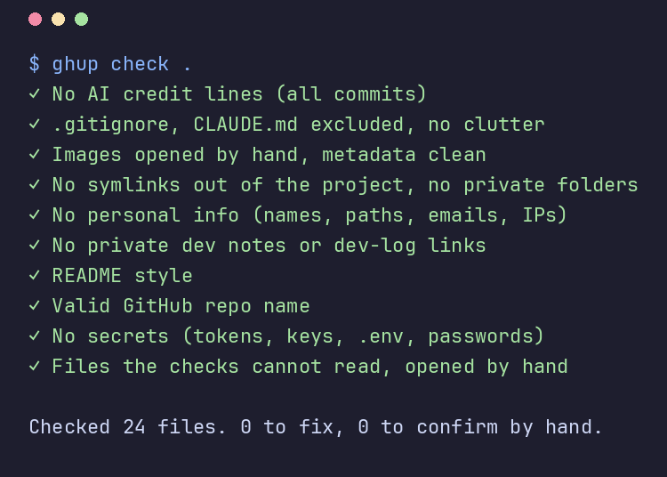
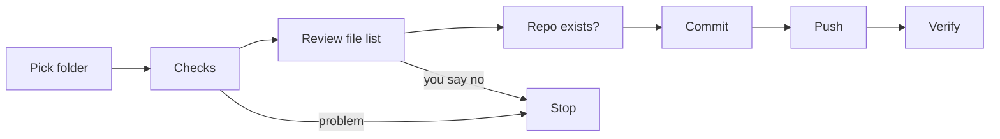

# github-uploader

**Checks a project for personal info and secrets, then pushes it to GitHub with its own push-only SSH key.**




## What is github-uploader?

Before a public upload, it is easy to miss a home path, a private note, a token or an AI credit line. Old commits and images can leak them too.
`ghup` runs safety checks on every file and every old commit, shows the exact file list, and pushes only after you say yes.

**It never holds a key that can create or delete repos: its own SSH key can only push.**

| You do | The tool does |
|---|---|
| Create an empty repo on github.com | Checks, commits, pushes, and verifies GitHub matches your folder |
| Type your passphrase once | Keeps the key unlocked for 15 minutes in its own ssh-agent |
| Rotate the key every 7 days | Blocks pushes with an older key |

## Features

- **10 safety checks**: personal info, secrets, private notes, AI credit lines, images, unreadable files, repo name, `.gitignore`, symlinks, README layout.
- **Full history scan**: old file versions and commit messages count, because GitHub keeps them.
- **Masked output**: personal values are shown as `a…e`, never in full.
- **Review before push**: shows the exact `git status` list; any file changed after the checks stops the upload.
- **Own SSH key**: ed25519 with a passphrase, used through its own ssh-agent. `~/.ssh` and `~/.ssh/config` are never used.
- **Pinned GitHub host key**: connects only to GitHub's published ed25519 key, over port 443.
- **Dry run**: shows every step and changes nothing.
- **No dependencies**: Python standard library, git and OpenSSH.

## How it works



## Quick start

**Requirements:** Linux, Python 3.11+, git, OpenSSH. exiftool is optional (checks image metadata).

**1. System packages**

| Distro | Command |
|---|---|
| Arch | `sudo pacman -S --needed git openssh python perl-image-exiftool` |
| Debian / Ubuntu | `sudo apt install git openssh-client python3 libimage-exiftool-perl` |
| Fedora | `sudo dnf install git openssh-clients python3 perl-Image-ExifTool` |
| openSUSE | `sudo zypper install git openssh python3 exiftool` |

**2. Get the app** (no Python packages needed)

```sh
git clone https://github.com/Muzasio/github-repo-uploader.git ~/.local/share/github-uploader
```

**3. Add the `ghup` command**

```sh
mkdir -p ~/.local/bin
printf '#!/bin/sh\nexec python3 -I "$HOME/.local/share/github-uploader/cli.py" "$@"\n' > ~/.local/bin/ghup
chmod 755 ~/.local/bin/ghup
```

`~/.local/bin` must be on your `PATH`.

**4. First run**

```sh
ghup setup              # your GitHub name, no-reply email, private folder
ghup key new            # make the key, then add it on github.com
cd <your project>
ghup upload . --dry-run # practice run, changes nothing
ghup upload .           # real upload, asks before each change
```

**Remove it**

```sh
rm ~/.local/bin/ghup
rm -rf ~/.local/share/github-uploader
rm -rf ~/.config/github-uploader ~/.local/state/github-uploader   # settings and the tool's key
```

Then delete the key on github.com/settings/keys.

## Settings

Set by `ghup setup`, stored in `~/.config/github-uploader/config.toml` (mode 600), outside every repo.

| Setting | Meaning |
|---|---|
| `github_name` | Your GitHub user name |
| `email` | Your GitHub no-reply email, used as the commit author |
| `devlog_dir` | A private folder: never uploaded from, never linked to |
| `private_words` | Extra words that must never appear in an uploaded file |
| `rotate_days` | Key age limit, default 7 |
| `unlock_minutes` | How long the key stays unlocked, default 15 |
| `skip_checks` | Check names to turn off |

## Known limits

- The tool cannot create repos. Create an empty one on github.com first.
- Checks find known patterns only. A name or word they do not know gets through: add it to `private_words`.
- Images, binary files and files over 5 MB are not read. You must confirm each one by hand.
- Binary or big files in **old commits** are not listed.
- `.gitignore` does not remove files that were already committed.
- Command line only.

## Troubleshooting

| Message | Fix |
|---|---|
| `no config yet: run ghup setup` | Run `ghup setup` |
| `no SSH key yet: run ghup key new` | Run `ghup key new` |
| `the key is N days old (limit 7)` | Run `ghup key rotate` |
| `GitHub did not accept the key` | Add the shown key on github.com/settings/ssh/new, then run `ghup key new` again |
| `... not found` at the Repo step | Create the repo on github.com, empty |
| `ghup: command not found` | Add `~/.local/bin` to your `PATH` |

## Status

- **Tested**: 55 unit tests on Python 3.11 and 3.14; one real upload to GitHub; the checks, the pipeline and the SSH key (15-minute unlock, 7-day limit) on an Arch-based distro.
- **Not tested yet**: Debian, Fedora and openSUSE; `ghup key rotate` against GitHub.
- **Planned**: a small Tk window.

## License

[MIT](LICENSE)

> [!WARNING]
> The checks lower the risk of a leak but cannot find everything. Always read the file list before you say yes.
